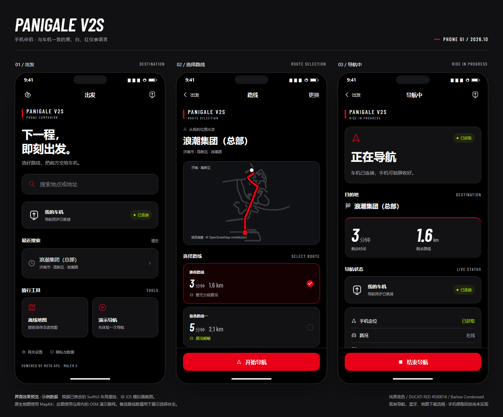

# iPhone UI：Ducati V2 个人适配

2026-10-16，手机端与现有车机统一为纯黑背景、白色主信息和 Ducati 红 `#E80016`。
App 名称仍为 MOTO GPS，保留原作者 Maler X 的署名、许可证及项目声明。

本页图片记录手机 UI 换肤阶段。随后新增的“南京骑行”入口、规则检查提示与路线核对开关
见[南京骑行实现记录](NANJING_MOTORCYCLE_NAVIGATION.md)，未包含在这些历史预览图中。

## 修改后的界面

- 出发：PANIGALE V2S 标识、目的地搜索、车机连接卡片、最近搜索、离线地图与演示导航。
- 路线：深色地图、红色选中路线、候选路线卡片和固定在底部的开始按钮。
- 导航中：状态卡片、目的地、大号剩余时间 / 距离、定位与地图状态、结束按钮。
- 车机详情：通用方形显示器图标、真实连接状态、连接控制与系统权限入口。
- 地图、网关、隐私：统一深色导航栏与红色强调色；下载范围改为红框并同步修改说明。

数字使用与车机相同的 Barlow Condensed SemiBold Italic，英文标签使用 Medium；
中文由系统字体回退显示。字体文件直接复制自已有仪表资源，SIL OFL 许可证随 App 保存。
`project.yml` 与 `App/Info.plist` 同时登记字体，避免 XcodeGen 重新生成时丢失配置。

界面根据现有 AppModel 的状态显示内容，不新增模拟读数到原生 App。
未配置网关、搜索中 / 失败、路线规划 / 失败、未连接、定位无权限与导航异常均保留相应入口。
原生导航栈仍由会话状态驱动，系统返回与边缘返回手势沿用原有清理行为。
辅助功能大字号下，工具卡片、设备状态和骑行数据改为纵向排列。

## 效果图的验证范围

这里的 PNG 是浏览器渲染的**界面效果预览，不是 iOS 模拟器或真机截图**。
预览使用示例已配置网关 / 已连接状态；真实 App 仍以设备与网关的实际状态为准。
预览地图来自仓库的济南 OSM 演示道路几何，原生 App 继续使用 Apple MapKit。
第二条候选路线的数值仅演示选择样式，不作为真实算路结果；这张图不会证明导航正确性。

- [三页总览](previews/ducati-ios-ui.png)
- [首页单页](previews/ducati-ios-home.png)
- [路线单页](previews/ducati-ios-route.png)
- [导航中单页](previews/ducati-ios-navigation.png)
- [可操作的离线 HTML 预览](previews/ducati-ios-ui.html)

HTML 支持搜索示例、路线选择、开始 / 结束、演示状态和查看设置面板，
不会访问真实网关或连接设备。可在浏览器地址后加 `?screen=home` 查看单页，
或加 `?screen=home&state=setup` 查看首次使用状态。

## 源码与生成

- 主题、卡片、数字字体与按钮：`platforms/ios/App/DucatiTheme.swift`。
- 主要页面与车机详情：`platforms/ios/App/ContentView.swift`。
- 路线地图颜色：`platforms/ios/App/RouteOverviewMap.swift`。
- 以上路径相对于 `third_party/moto-gps-waveshare/`。
- 重新生成 HTML：在仓库根目录运行 `python tools/generate_ios_ui_preview.py`。
  生成器读取原生主题色、同一份字体和已有 OSM 演示几何；布局为人工对应的 HTML，
  后续更改原生布局时也需要同步更新生成器。

## UI 换肤阶段的检查记录

- 24 个 App Swift 文件通过 tree-sitter Swift 语法解析。
- 保留原有 UI accessibilityIdentifier，字体文件与既有原件逐字节一致，plist 可解析。
- AppModel、BLE 适配器与导航运行时没有修改。
- HTML 预览在 320、375、430 宽度下检查三页横向溢出，并检查预览中的搜索、路线选择、
  开始 / 结束和设置面板交互。
- `git diff --check` 通过。

上述为源码和预览检查。Windows 环境没有 Xcode，本次未进行 SwiftUI 类型检查、
iOS 编译、模拟器或真机运行；Dynamic Type、系统返回手势、MapKit、BLE 和锁屏行为仍需在 iOS 验收。
倾角记录、手机倾角回放和摩托车专用算路不在此次 UI 修改范围内。
